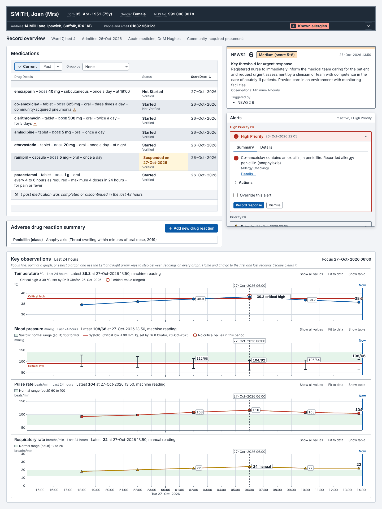
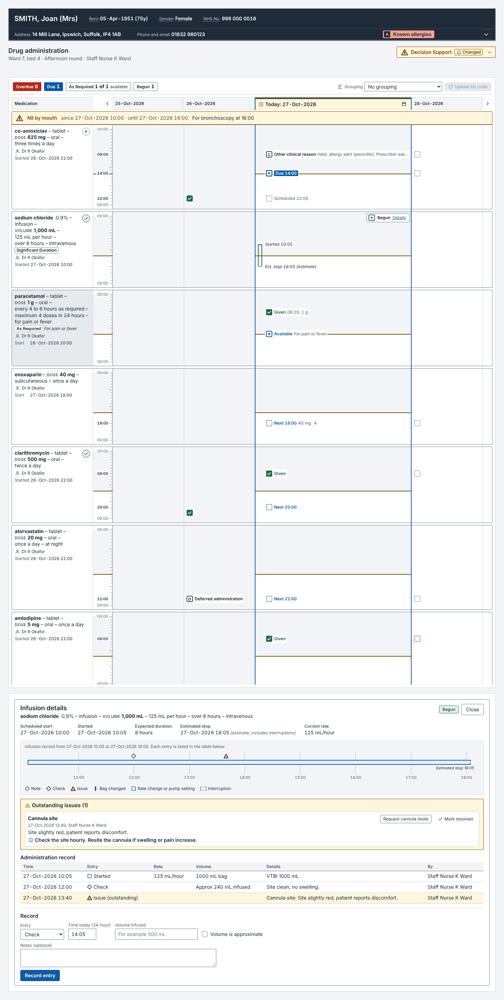
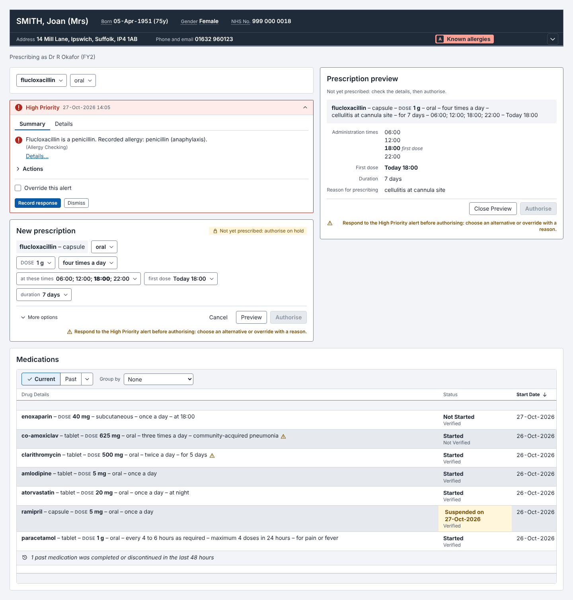
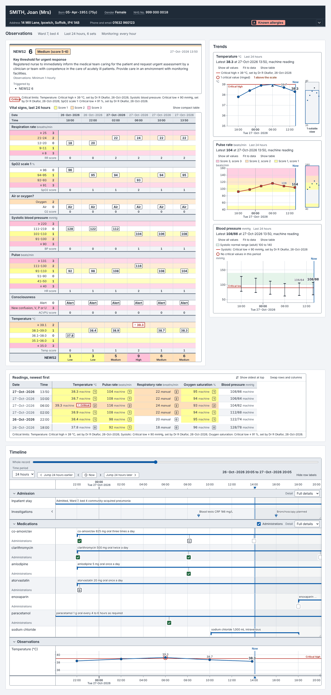
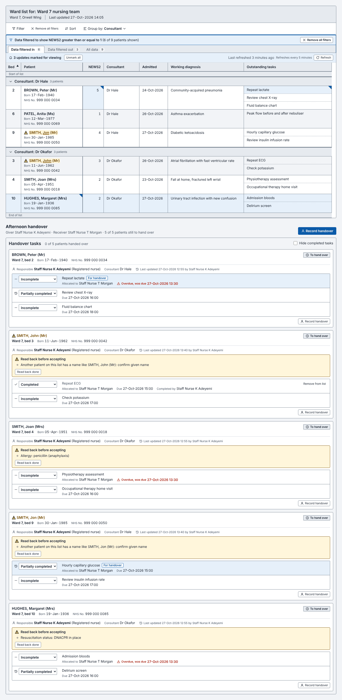
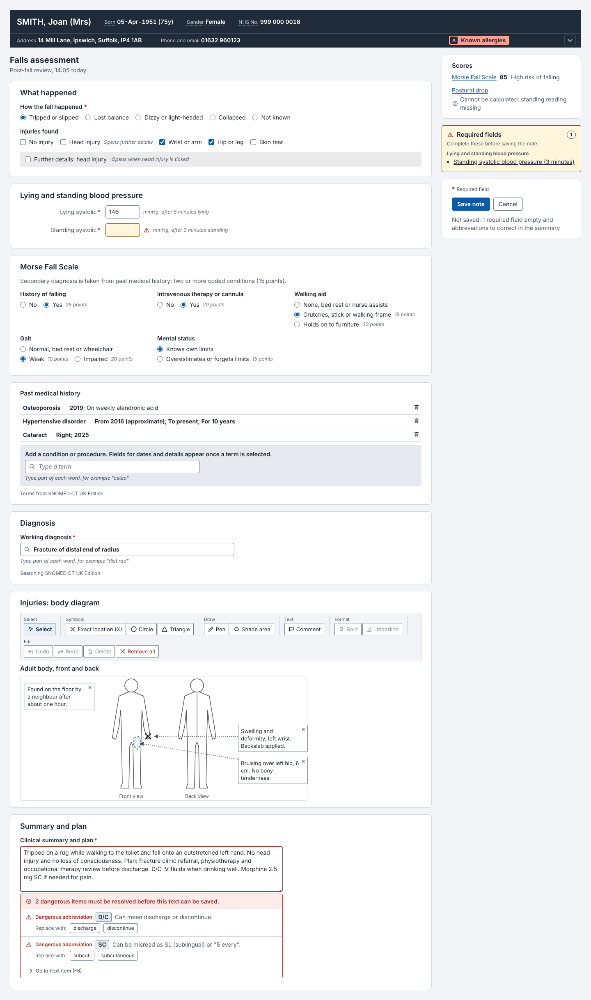
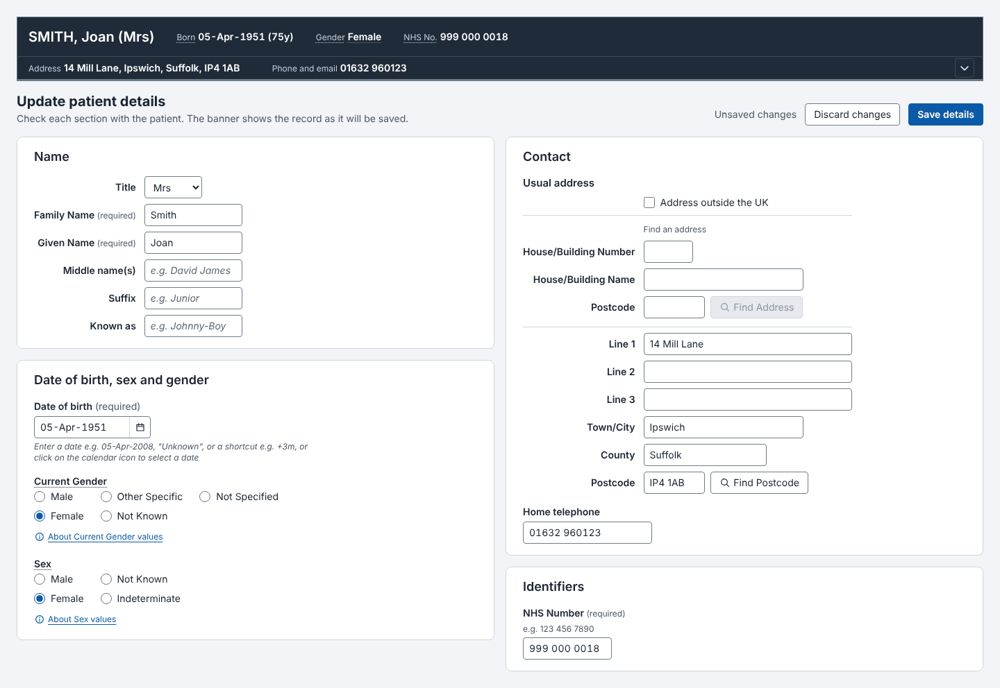
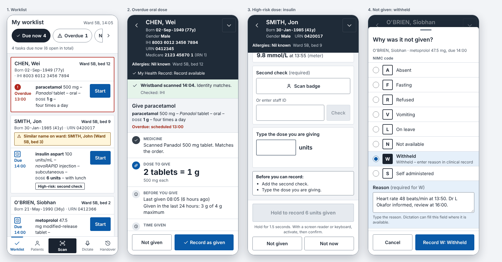
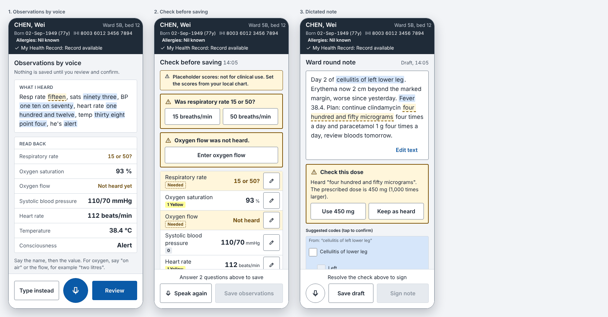
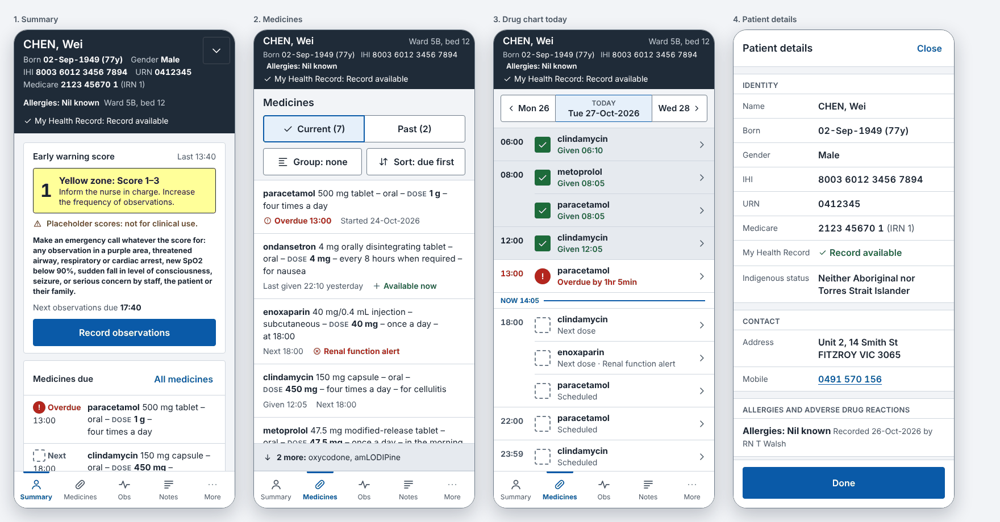

# Clinical CUI

React 18 + TypeScript controls for clinical applications in the UK, Australia and New Zealand. Built from the NHS Common User Interface (CUI) design guidance, with Australian (ACSQHC, ADHA, ABS/METeOR) and New Zealand (HISO, HQSC, Stats NZ) standards layered on top. 179 documented controls (33 of them for mobile touch and dictation) and over 900 exports (components, hooks, pure utilities, region data), each tracing back to guideline IDs or a national source.

## Contents

| Area | Folder | Controls |
| --- | --- | --- |
| Foundations | `src/core` | Button, Icon, VisuallyHidden, ClinicalLocaleProvider, shared date/time formatters |
| Patient identification | `src/patient` | PatientBanner, MicroPatientBanner, LabelledValue, PatientNameDisplay/Input, GenderDisplay, SexGenderInput, AddressDisplay/Input, TelephoneNumberDisplay/Input, PatientIdentifierDisplay/Input; GB NhsNumberDisplay/Input; AU IhiDisplay/Input, MedicareNumberDisplay/Input, DvaNumberInput, HpiNumberDisplay, IndigenousStatusDisplay/Input; NZ NhiDisplay/Input, EthnicityDisplay/Input, MaoriDescentInput, IwiInput; MyHealthRecordStatus (AU), ProtectionFlagInput (NZ), PartialDateOfBirthDisplay/Input, SensitiveCharacteristicDisplay/Input |
| Dates, times, display standards | `src/datetime` | DateDisplay, TimeDisplay, DateTimeDisplay, TimeRangeDisplay, DurationDisplay, DateInput, CalendarPicker, DisambiguationPrompt, TimeInput, DurationInput, TruncatedText, ClinicalTermList, Abbreviation, AbbreviationCheckedTextArea, AlertSymbol, IconButton, IconToolbar, EncodableTextEditor, ShortcutProvider, KeyboardShortcutList |
| Lists, timeline, graphs, observations, handover | `src/lists` | PatientList, PatientIdentificationCell, SubList, UpdateMarker, HistoricalSnapshotBanner, SortIndicator, DataToolbar, HeaderCellFilter, FilterDialog, FilterNotification, SortDialog, ColumnChooser, TimelineView, ObservationGraph, GraphStack, GraphThumbnail, ObservationTable, VitalSignsChart, EarlyWarningScoreSummary, HandoverTaskList, HandshakeDialog |
| Medications | `src/medications` | MedicationLine, MedicationsList, MedicationActionSummaryDialog, DrugSearch, QuickList, CascadeSelector, SelectionTrail, TemplatePrescriptionList, TemplateReopenControl, PrescriptionForm, PrescriptionDetailForm, PrescriptionPreview, AdrRiskList |
| Drug administration, decision support | `src/administration` | DrugAdministrationChart, DayNavigator, AdministrationEventIcon, AdministrationRecordingForm, InfusionDetailView, NilByMouthBanner, AdrSummaryList, AdrDetailsView, AdrRecordingDialog, DecisionSupportStatusIndicator, DecisionSupportChangeToast, AlertIndicator, AlertContainer, AlertItem, InformationWindow, PreferenceIcon, PreferenceChoiceList |
| Clinical noting, terminology | `src/noting` | FormField, ClinicalRadioGroup, ClinicalCheckboxGroup, RequiredFieldIndicator, MissedRequiredFieldsPanel, RevealSection, PreviousValuesPopover, CalculatedValue, NoteEntryList, NaturalDateInput, FreeTextAnnotation, AnnotatedGraphicCanvas, GraphicToolbar, GraphicPicker, TerminologySearch, ConceptFlyout, SuggestedMatchList, SingleConceptEncoder, MandatoryQualifierSelect, SubsetFilterControl, HierarchyBrowserDialog, MeasuredValueInput, AxisModifierWarning, SpellCheckPopover, ShorthandResolver, NoMatchReport; experimental: ClinicalStatement, StatementList, TemplateSearch, SectionSearch, TemplateBrowseTree, TemplateSuggestionsPanel, RepeatableFieldGroup, SectionOrderToggle, CarePathwayStack, CarePathwayCycle, PathwayTimeline, TemplateTriggerText |
| Mobile touch inputs | `src/touch` | TouchButton, ActionBar, ChipGroup, SegmentedControl, BottomSheet, FullScreenSheet, TouchDateTimePicker, NumberPad, ObservationKeypadEntry, HoldToConfirmButton, TypedReadBackConfirm, SecondCheckField, UndoToast, ReasonCodePicker |
| Mobile screens | `src/mobile` | MobilePatientHeader, PatientDetailsSheet, PatientSwitchGuard, IdentityScanResult, MobileTabBar, MobileNavBar, Worklist, WorklistTaskCard, MobileMedicationsList, DoseAdministrationFlow, NotGivenSheet, MobileDrugAgenda, MobileSummary |
| Mobile voice | `src/voice` | SpeechEngine (adapter, WebSpeechEngine, ScriptedSpeechEngine, useSpeechDictation), MicButton, LiveTranscript, DictatedObservationsCapture, DictationReview, DictatedNoteReview |

Each component folder holds the `.tsx`, its `.css`, a `.test.tsx`, a `README.md` (when to use, what you provide, guidance implemented with IDs, regional behaviour, do and don't, accessibility) and a `preview.html`.

## Mobile

The mobile controls follow the approved concepts in `docs/mobile-concepts/`: a task-first worklist for nursing, a patient-first record for review, and voice capture inside both. Touch targets are at least 48px (commit actions 56px, at the bottom), nothing depends on hover, swipe never commits or deletes, high-risk doses need a typed read-back, a second check and hold-to-confirm, and dictation never saves anything until each value has been read back and every missing or ambiguous value has been answered. The speech engine is yours to supply through the `SpeechEngine` adapter; the browser Web Speech adapter is optional (some browsers send audio to the vendor's cloud, so check this against your privacy obligations).

## Regions

```tsx
import { ClinicalLocaleProvider } from '@clinical-cui/react';

<ClinicalLocaleProvider region="NZ" teReoLabels>        {/* 'GB' (default) | 'AU' | 'NZ' */}
  <PatientBanner ... />                                {/* NHI, HQSC allergy states, HISO 10046 names */}
</ClinicalLocaleProvider>

<ClinicalLocaleProvider region="AU" timeZone="Australia/Brisbane">
  <MedicationLine ... />                               {/* ACSQHC on-screen order, mixed-case lettering */}
</ClinicalLocaleProvider>
```

Any region-aware control also takes a `region` prop. What changes per region: identifiers and their validation (NHS number; IHI, Medicare, DVA, HPI; NHI, HPI), name casing and macrons, sex and gender value sets, Indigenous status (AU), ethnicity, Māori descent and iwi (NZ), address and telephone formats, allergy wording, medication line order and lettering lists, dangerous abbreviation lists, drug chart administration codes (NIMC, HQSC NMC), time zones and daylight saving, SNOMED CT edition and language reference sets, early warning presets (NEWS2, ADDS placeholders, NZEWS).

## See it in use

Ten worked screens show how the controls come together. Open `docs/site/index.html` in a browser (no server needed): every example has a region switch (UK, Australia, New Zealand) and light and dark themes, and every component also has its own page. The TSX source for each screen is in `examples/`, written as the reference for composing the controls.

| Desktop | |
| --- | --- |
|  Patient record overview |  Drug round |
|  Prescribing |  Observations |
|  Ward list and handover |  Clinical note |
|  Patient registration | |

| Mobile |
| --- |
|  Nurse medication round |
|  Voice capture |
|  Patient review on a phone |

Screenshots for every region and the dark theme are in `docs/screens/` (`-au`, `-nz`, `-gb`, `-dark` suffixes). Rebuild them with `npm run build && npm run examples && npm run screens -- --all-regions`.

## Getting started

```bash
npm install
npm run build      # tokens.css, dist/bundle.js (window.ClinicalCUI), dist/esm, dist/types
npm test           # 1,567 tests: utilities and every component (jsdom)
npm run previews   # renders every preview in light and dark with Playwright, fails on console errors
```

```tsx
import { PatientBanner, MedicationLine, DateInput } from '@clinical-cui/react';
import '@clinical-cui/react/dist/esm/index.css';   // component styles
import '@clinical-cui/react/src/styles/tokens.css'; // design tokens (light + dark)

<html data-theme="light">
  <div className="cui-root">
    <PatientBanner patient={patient} allergies={allergies} />
  </div>
</html>
```

The controls never fetch data: drug search, terminology search and postcode lookup are functions you pass in.

## Design tokens

`design/tokens.json` is the source of truth (colours for light and dark, type, spacing, radius, shadow). `npm run build` regenerates `src/styles/tokens.css`. `node scripts/contrast.mjs design/tokens.json` checks every text, border and focus pair against WCAG (4.5:1 text, 3:1 borders and focus) in both themes.

The CUI guidance does not prescribe colours or fonts, so the palette is this library's own. It keeps the colour meanings the guidance fixes: red no-go, yellow caution, green acceptable, blue advisory only, never colour alone.

## Traceability

- `docs/guidance-notes/G1..G9` are the distilled notes from all 54 NHS CUI documents, with every guideline ID and exact rule. `G10-australia.md` and `G11-new-zealand.md` are the regional specifications, with a source URL on every item.
- `docs/DECISIONS.md` lists where the source documents conflict or are silent, and what was chosen.
- `CONVENTIONS.md` is the contributor guide: folder layout, styling rules, README and preview formats, build checks.

## Before production use

`docs/DECISIONS.md` lists what must be verified against primary sources (lettering list casing, NZEWS and ADDS bands and scores, SNOMED CT edition identifiers, te reo labels) and the few items not yet built.
